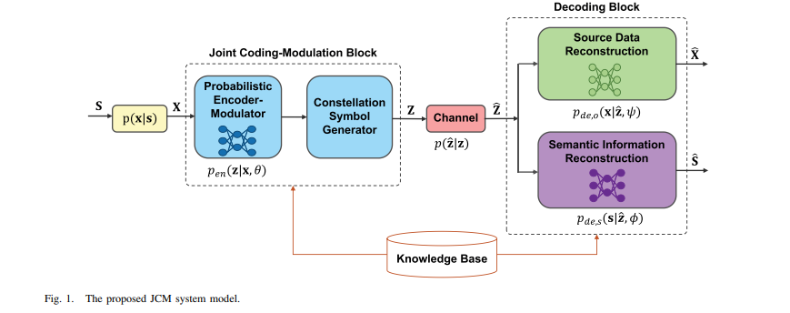
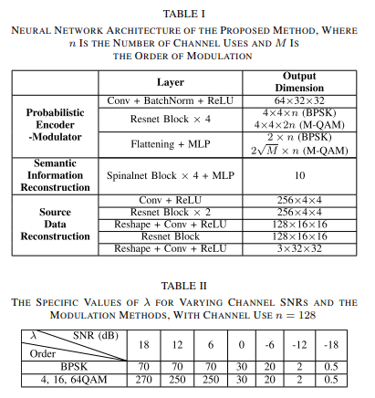
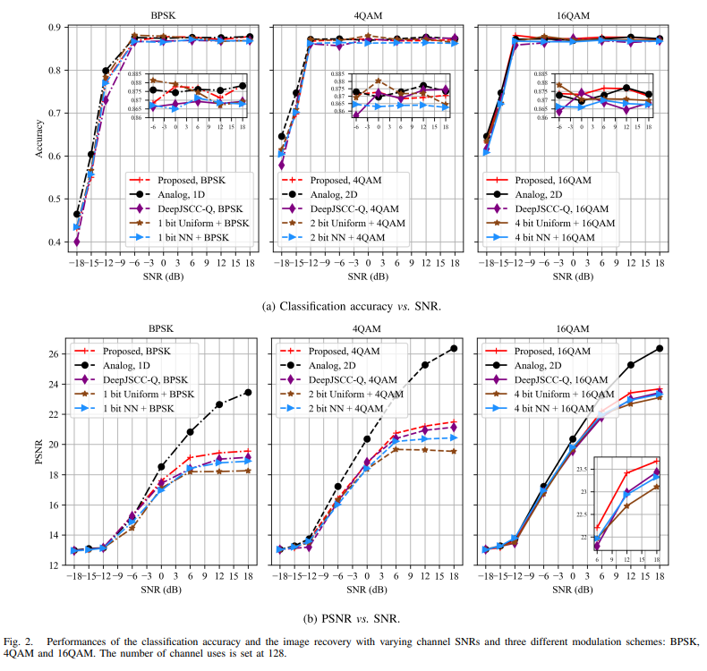
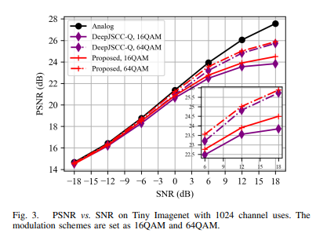
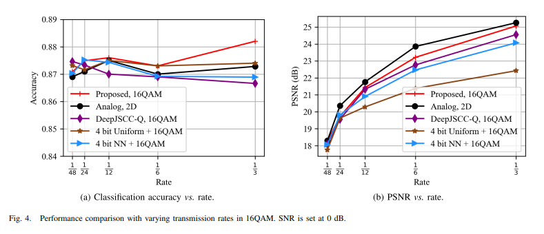
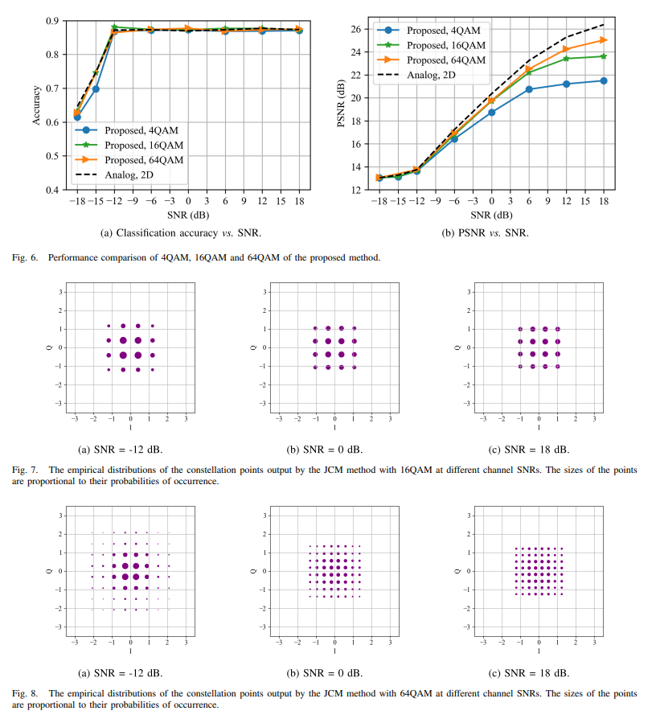

# [Coding and Modulation]Breakthrough in Traditional Communication Paradigms! Joint Coding and Modulation Technology Based on Variational Autoencoders for Digital Semantic Communication[with Python code]

Private message for your attention! Breaking through the traditional paradigm of communication! In the context of accelerating the evolution of 6G wireless communication technology, the traditional paradigm centered around "transmitting bits" is no longer sufficient to meet the demands of emerging scenarios such as the metaverse, intelligent surveillance, and robotic collaboration for efficient communication and task adaptability. Semantic communication, as a "beyond Shannon" novel paradigm, significantly enhances data transmission efficiency in resource-constrained scenarios by extracting and transmitting highly relevant semantic information to the receiver's task.
However, current mainstream semantic communication systems rely on neural networks for end-to-end design, using analog modulation to directly transmit continuous signals, facing challenges such as complex hardware implementation and poor compatibility with existing digital communication protocols. Transitioning to digital modulation encounters two major core issues: first, digital modulation requires mapping continuous signals into discrete constellation symbols, an operation that has non-differentiable properties and cannot be optimized using the commonly used stochastic gradient descent algorithm in neural networks; second, existing quantization schemes do not consider the matching between channel conditions and the modulation process, leading to performance degradation.
To address these pain points, a team from Shanghai Jiao Tong University proposed a joint coding and modulation (JCM) framework based on Variational Autoencoders (VAE), which has been published in IEEE TRANSACTIONS ON COMMUNICATIONS (September 2024, Impact Factor 11.1). This framework innovatively addresses the non-differentiability issue of digital modulation and achieves deep adaptation of encoding, modulation, and channel conditions, providing a key technical path for the engineering implementation of semantic communication.
The core design of the JCM framework: Solving the two major challenges of digital semantic communication. The JCM framework is based on the VAE's probability coding architecture, reconstructing the transmission link of digital semantic communication through two core ideas: "probabilistic modeling" and "joint training."
1. Probabilistic modulation: Traditional digital modulation requires deterministic mapping of continuous signals into discrete constellation symbols, which cannot be integrated into neural network gradient optimization due to the "non-continuous" nature. The JCM framework innovatively changes the modulation approach:
•  
Learning transition probabilities instead of generating deterministic symbols: Transmitter's probability encoding - The modulator learns the optimal transition probabilities from source data to each constellation symbol through a neural network (e.g., the 0/1 symbol probabilities for BPSK, the amplitude probabilities for I/Q channels in M-QAM), rather than directly outputting fixed symbols.
•  
Randomly generate astrological sequence: Based on the learned transition probabilities, randomly generate a discrete astrological symbol sequence that meets the channel transmission requirements and then feed it into the channel. This process utilizes the Gumbel-Softmax reparameterization technique to simultaneously generate discrete symbols during forward propagation and approximate the non-differentiable argmax operation with a differentiable Softmax function during backpropagation, perfectly integrating end-to-end training for neural networks.
2. Joint Optimization: Deep Matching of Coding-Modulation-Channel to Solve the "Modulation and Channel Mismatch" Problem, JCM Framework incorporates coding, modulation, and decoding processes into a unified training system:
•  
End-to-end joint training: During the training process, channel noise (such as additive white Gaussian noise AWGN) is fully considered. The sender encoder-modulator and the receiver two decoders (which respectively reconstruct source data and semantic information) are optimized in coordination to ensure that the learned transition probability can adaptively match the current channel state.
•  
Information-theoretic loss function: Based on the Info-Max principle (maximizing mutual information), we derive a variational inference lower bound (VILB) with physical significance as the loss function. This function optimizes both "semantic information and the mutual information between the received signal" and "source data and the mutual information between the received signal", ensuring accuracy in semantic tasks (such as image classification) while improving the reconstruction quality of source data (such as images).
•  
Sending end: Containing a joint encoding - modulation module, consisting of "Probability Encoding - Modulator" and "Quaternary Symbol Generator." The input source data (such as images) undergoes transition probability learning by the Probability Encoding - Modulator to generate a discrete quaternary sequence Z that meets power constraints, which is then sent into an AWGN channel.

•
Receiving end: Sets up two parallel decoders, respectively reconstructing the source data and semantic information (such as image classification labels) through the maximum a posteriori probability (MAP) algorithm. Using a parallel architecture instead of a cascaded one, avoids information loss due to "reconstructing data before extracting semantics."

Key technical supplement 1:
Transition probability modeling: For mainstream modulation methods like BPSK and M-QAM, simplified probability models are designed separately. For example, M-QAM treats the I/Q channels as conditionally independent, requiring only learning likelihood (not M classes), significantly reducing computational complexity.

2
Image semantic communication adaptation: Incorporating the characteristics of image data, assuming the source data and its reconstruction results follow a multivariate Gaussian distribution, the loss function is specifically formulated as a weighted form of "cross-entropy (classification semantics) + mean square error (image reconstruction)," balancing semantic tasks with data quality.

III. Experimental verification: Performance surpasses existing schemes. Teams on CIFAR-10 (32×32 color images) and Tiny ImageNet (64×64 color images) datasets have demonstrated superiority in terms of channel adaptability, transmission rate, and modulation order compared to JCM and four mainstream schemes (simulated modulation, uniform quantization, learning quantization, DeepJSCC-Q).

1. Channel adaptability: Significant advantage under high signal-to-noise ratio (SNR) range from -18dB to 18dB (using 16QAM as an example):
•
Semantic task (classification accuracy): All schemes maintain near high accuracy across various SNR levels (approximately 87%), indicating stronger robustness of semantic information against channel noise.
Data Reconstruction (PSNR): At low SNR (≤-6dB), JCM closely matches the performance of analog modulation; at high SNR (e.g., 18dB), JCM improves by 1.3dB, 0.7dB, and 0.4dB respectively compared to uniform quantization, learning quantization, and DeepJSCC-Q, and the gap in performance with analog modulation decreases as the number of modulation levels increases (1.9dB for 16QAM, 1.4dB for 64QAM).
2. Transfer Rate: The efficient transmission rate r (number of channel uses / image dimension) is improved from 1/48 to 1/3 when the SNR=0dB, 16QAM:
•  
The PSNR of JCM increases by up to 6dB with the rate increase, and it consistently outperforms the digital benchmark scheme across all rates. For example, at r=1/6, JCM is 0.4dB higher than DeepJSCC-Q and 1.7dB higher than uniform quantization, while only 0.7dB lower than analog modulation.
•  
The accuracy of semantic classification has always been stable at about 87%, proving the efficiency of JCM in "low-rate transmission of semantic information" scenarios.
3. Modulation order: Higher order modulation has superior performance compared to 4QAM, 16QAM, and 64QAM (SNR=18dB):
•  
Performance Improvement: The PSNR of 64QAM is 1.4dB higher than that of 16QAM, and 3.5dB higher than that of 4QAM. Additionally, the gap with analog modulation has been reduced from 4.8dB (4QAM) to 1.4dB (64QAM).
•  
Training Efficiency: Although the neural network parameters of 64QAM (49.8M vs 24.6M) are more, the convergence speed is basically consistent with that of lower order modulations, and the training time for a single round only increased by about 30% (from 83s to 110s), which demonstrates the scalability of the framework.
4. Probabilistic Formation Capability: Adaptive Matching Channel Characteristics JCM also exhibits excellent "probabilistic formation" capability: at low SNR, the probability distribution of constellation symbols is close to the Gaussian distribution optimal for an AWGN channel; as SNR increases, it gradually transitions to a uniform distribution (as shown in Figure 2, constellation distribution under different SNRs for 16QAM). This characteristic does not require explicit distribution instructions for the neural network but is fully realized through joint training, reflecting its adaptive matching capability to channel conditions.
IV. Summary and Outlook JCM framework, through "probabilistic modulation" and "joint optimization", first solves the two core problems of "non-differentiability" and "channel mismatch" in digital semantic communication at the same time, its advantages can be summarized into three points:
1  
Performance superior: Under multi-channel conditions, multiple transmission rates, and multiple modulation orders, it comprehensively surpasses existing digital semantic communication schemes, and the performance gap with analog modulation decreases as the order of modulation increases.
2  
Easy to implement: outputs discrete constellation symbols, compatible with existing digital communication hardware and protocols, solving the engineering challenge of analog semantic communication.
3  
Self-adaptation: Probability shaping can be automatically realized, without the need for manual intervention to match channel characteristics, reducing the complexity of actual deployment.
In the future, the team will further optimize the celestial body geometrical shaping design and explore more efficient modulation methods such as non-uniform celestial bodies, continuously promoting the practical application process of semantic communication in 6G scenarios.
End

## Images

<!-- PAYMENT_BLOCK -->

## Get this dataset

- Payment link (Stripe): [Buy now](https://buy.stripe.com/3cs8yP7sY87d0vu9AB)
- Payment QR code: 

<!-- /PAYMENT_BLOCK -->
